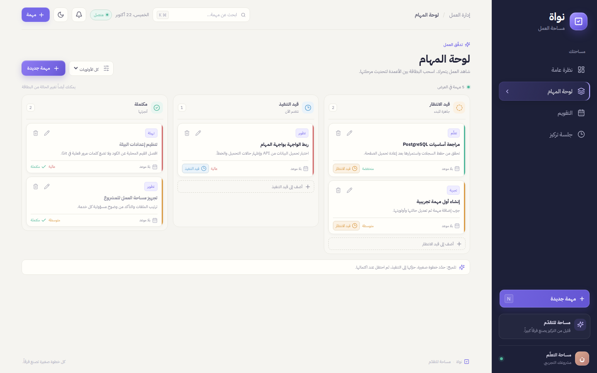
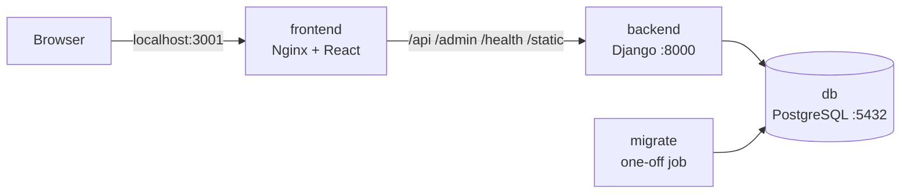

# المثال السادس — تطبيق كامل بأربع خدمات عبر Docker Compose

تطبيق عربي لإدارة المهام اسمه **نواة**: واجهة React، وخلفية Django REST Framework، وقاعدة PostgreSQL.
كل الخدمات تعمل معاً بأمر واحد.




> كود التطبيق نفسه (React و Django) مشروع تدريبي جاهز حصلت عليه لأتدرّب عليه.
> عملي في هذا المثال هو كل ما يخص Docker: ملفات Dockerfile، وملف nginx.conf، وملف compose.yml.

## الخدمات الأربع



| الخدمة | الصورة | وظيفتها | المنفذ على الجهاز |
|---|---|---|---|
| `db` | `postgres:latest` | قاعدة البيانات | 5444 (اختياري) |
| `migrate` | تُبنى من `backend` | تطبّق الترحيلات ثم تنتهي | لا يوجد |
| `backend` | تُبنى من `backend` | الواجهة البرمجية | 8001 (اختياري) |
| `frontend` | تُبنى من `frontend` | موقع React وتمرير الطلبات إلى Django | 3001 |

## ترتيب التشغيل

القاعدة تحتاج بضع ثوانٍ لتصبح جاهزة.
لو بدأ Django قبلها فسيفشل الاتصال. لذلك رتّبنا البدء بثلاث خطوات:

1. `db` تبدأ، ويفحصها Compose كل خمس ثوانٍ بالأمر `pg_isready`.
2. `migrate` لا تبدأ إلا عندما يصبح فحص `db` ناجحاً، أي الشرط `service_healthy`.
3. `backend` لا تبدأ إلا بعد أن تنتهي `migrate` بنجاح، أي الشرط `service_completed_successfully`.

لماذا خدمة منفصلة للترحيل؟
لو وضعنا الترحيل داخل أمر تشغيل الخلفية، لتكرّر مع كل إعادة تشغيل.
ولو شغّلنا أكثر من نسخة من الخلفية، لحاولت كل نسخة الترحيل في الوقت نفسه.
الخدمة المنفصلة تنفّذه مرة واحدة، وفي الترتيب الصحيح.

## كيف يصل المتصفح إلى Django؟

المتصفح يتعامل مع عنوان واحد فقط: `localhost:3001`.
خادم Nginx في حاوية الواجهة يقرّر حسب المسار:

- المسارات `/api/` و `/admin/` و `/health/` و `/static/` يمرّرها إلى `backend:8000`.
- أي مسار آخر يقدّم له ملفات React.

هذا اسمه **الوكيل العكسي**.
فائدته أن الواجهة والخلفية تظهران للمتصفح كأنهما موقع واحد، فلا نحتاج إعدادات CORS.
والكلمة `backend` في ملف `nginx.conf` هي اسم الخدمة في ملف Compose.

## التشغيل

```bash
cd example-6-fullstack-compose
```

```bash
cp backend/.env.example backend/.env
```

```bash
docker compose up -d --build
```

افتح المتصفح على: `http://localhost:3001`

حالة الخدمات بعد التشغيل (ناتج حقيقي):

```text
NAME                                     SERVICE    STATUS
example-6-fullstack-compose-backend-1    backend    Up 3 seconds
example-6-fullstack-compose-db-1         db         Up 11 seconds (healthy)
example-6-fullstack-compose-frontend-1   frontend   Up 3 seconds
example-6-fullstack-compose-migrate-1    migrate    Exited (0) 3 seconds ago
```

الحالة `Exited (0)` لخدمة `migrate` طبيعية: الرقم صفر يعني أنها انتهت بنجاح.

فحص الخدمة واتصال القاعدة:

```bash
curl http://localhost:3001/health/
```

```json
{"status": "ok", "database": "ok", "date": "2026-10-22"}
```

تشغيل اختبارات الخلفية داخل الحاوية:

```bash
docker compose exec backend python manage.py test
```

```text
Ran 15 tests in 0.143s

OK
```

إنشاء مستخدم للوحة الإدارة:

```bash
docker compose exec backend python manage.py createsuperuser
```

الإيقاف:

```bash
docker compose down
```

البيانات تبقى في مساحة التخزين. لحذفها أيضاً أضف `-v`، وانتبه لأن ذلك يمسح القاعدة.

## الملفات المهمة

| الملف | ما فيه |
|---|---|
| `compose.yml` | تعريف الخدمات الأربع، مع شرح لكل سطر |
| `backend/Dockerfile` | صورة Django، وفي آخره الطريقة اليدوية بدون Compose |
| `frontend/Dockerfile` | بناء متعدد المراحل: Node للبناء، ثم Nginx للتقديم |
| `frontend/nginx.conf` | تقديم الموقع وتمرير الطلبات إلى Django |
| `backend/.env.example` | متغيّرات Django و PostgreSQL |

## مشكلتان وجدتهما وأصلحتهما أثناء المراجعة

**1) فشل تسجيل الدخول إلى لوحة الإدارة عبر المنفذ 3001.**
كان Nginx يرسل الترويسة `Host` بدون رقم المنفذ.
فيرى Django أن الطلب قادم من `localhost:3001` بينما الموقع `localhost`، فيرفضه:

```text
Origin checking failed - http://localhost:3001 does not match any trusted origins.
```

الحل: استخدام `$http_host` بدل `$host` في `nginx.conf`، لأنها تحتفظ بالمنفذ.

**2) لوحة الإدارة بلا تنسيق عبر المنفذ 3001.**
طلبات ملفات التنسيق `/static/...` لم تكن تُمرَّر إلى Django،
فكان Nginx يرد عليها بصفحة `index.html` بدل ملف CSS.
الحل: إضافة قسم `/static/` إلى `nginx.conf`.

## الواجهة البرمجية

| الطلب | الوظيفة |
|---|---|
| `GET /api/v1/tasks/` | عرض المهام، مع البحث والتصفية والترتيب والصفحات |
| `POST /api/v1/tasks/` | إنشاء مهمة |
| `GET /api/v1/tasks/{id}/` | تفاصيل مهمة |
| `PUT` أو `PATCH /api/v1/tasks/{id}/` | تعديل مهمة |
| `DELETE /api/v1/tasks/{id}/` | حذف مهمة |
| `GET /api/v1/summary/` | ملخص الأعداد ونسبة الإنجاز |
| `GET /api/v1/calendar/?month=2026-10` | مهام شهر واحد للتقويم |
| `GET` و `POST /api/v1/focus-sessions/` | جلسات التركيز |
| `GET /health/` | فحص الخدمة واتصال القاعدة |
| `/admin/` | لوحة إدارة Django |

قيم الحالة: `todo` و `in_progress` و `done`.
قيم الأولوية: `low` و `medium` و `high`.

## متغيّرات البيئة

| المتغيّر | معناه |
|---|---|
| `DJANGO_SECRET_KEY` | مفتاح Django السري |
| `DJANGO_DEBUG` | وضع التطوير: القيمة 1 تشغّله والقيمة 0 توقفه |
| `DJANGO_ALLOWED_HOSTS` | أسماء المواقع المسموحة، مفصولة بفواصل |
| `POSTGRES_DB` و `POSTGRES_USER` و `POSTGRES_PASSWORD` | بيانات القاعدة |
| `POSTGRES_HOST` و `POSTGRES_PORT` | عنوان القاعدة. في Compose نضعه `db` |
| `CORS_ALLOWED_ORIGINS` | مطلوب فقط عند تشغيل Vite للتطوير على المنفذ 5173 |

## تنبيه

كلمة مرور القاعدة مكتوبة هنا في مكانين: في `compose.yml` وفي `backend/.env`، ويجب أن تتطابقا.
في المثال السابع نحل ذلك بمتغيّرات تُقرأ من ملف `.env` واحد.
